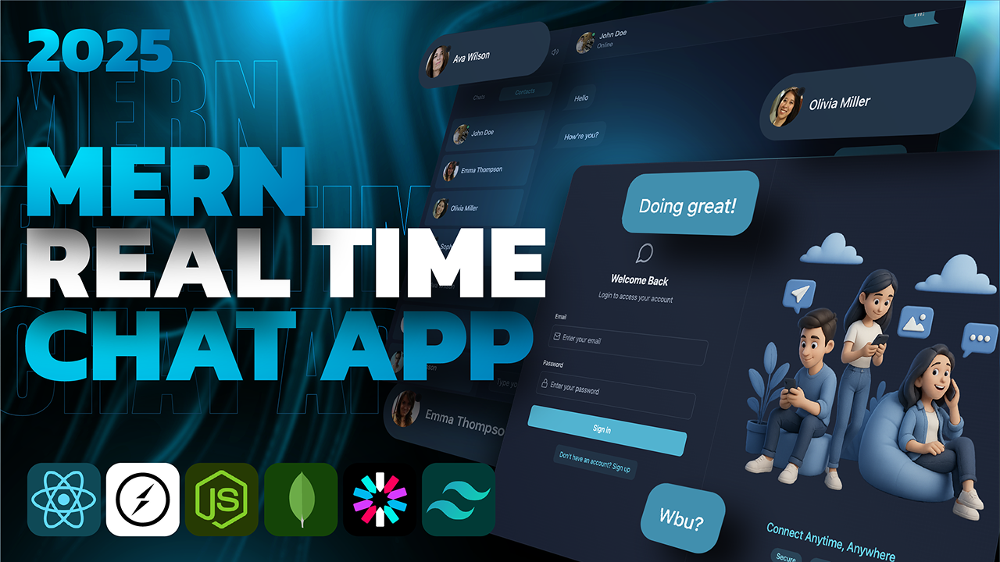
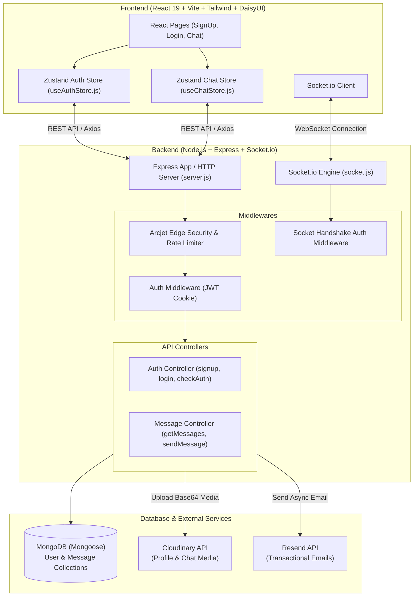

# ⚡ Chatify — Full-Stack Real-Time Messaging Platform

<p align="center">
  A production-ready, full-stack real-time messaging application built with <b>Node.js</b>, <b>Express</b>, <b>Socket.io</b>, <b>MongoDB</b>, <b>React 19</b>, and <b>Zustand</b>. Featuring custom JWT authentication in secure HTTP-only cookies, live presence detection, optimistic UI rendering, audio alerts, and cloud media delivery.
</p>

<p align="center">
  
  
  
  
  
  
  
</p>

---

## 📸 Application Previews

### Chat Interface


<p align="center">
  
  
</p>

---

## 🚀 Key Highlights & Features

- ⚡ **Real-Time 1-to-1 Messaging:** Bi-directional, sub-100ms message delivery powered by persistent **Socket.io** TCP connections.
- 🟢 **Live Online/Offline Presence:** Real-time presence broadcasting across all connected client sessions.
- 🔐 **Custom JWT Authentication:** Tokens stored exclusively in **secure, HTTP-Only cookies** (`SameSite: strict`) to prevent XSS and CSRF token theft.
- ⚡ **Optimistic UI Updates:** Messages immediately append to the conversation bubble with temporary identifiers for instant responsiveness before server round-trips.
- 🖼️ **Cloud Media Sharing:** Seamless image uploads and hosting powered by **Cloudinary**.
- 🔔 **Interactive Sound Alerts:** Notification chime on incoming messages with user-toggle persistence saved in `localStorage`.
- 🛡️ **Edge Security & Rate Limiting:** Bot detection, SQL/XSS shield, and sliding-window rate limiting powered by **Arcjet**.
- 📨 **Transactional Emails:** Asynchronous welcome and onboarding emails triggered upon registration via **Resend**.
- 🎨 **Responsive UI & Themes:** Sleek, modern interface built with **React 19**, **Tailwind CSS**, and **DaisyUI** themes.

---

## 🏗️ System Architecture



---

## 🛠️ Tech Stack & Tools

| Layer | Technologies |
|---|---|
| **Frontend** | React 19, Vite, Tailwind CSS, DaisyUI, Zustand, Axios, Lucide React, React Hot Toast |
| **Backend** | Node.js, Express.js, Socket.io, Cookie-Parser, Cors, Bcryptjs, JsonWebToken |
| **Database & ODM** | MongoDB Atlas, Mongoose |
| **Media & Services** | Cloudinary (Image Hosting), Resend (Email Delivery), Arcjet (Security & Rate Limiting) |

---

## 📡 REST API Reference

### 🔐 Authentication (`/api/auth`)

| Method | Endpoint | Description | Auth Required |
|---|---|---|---|
| `POST` | `/api/auth/signup` | Register user, hash password, issue JWT cookie, send welcome email | No |
| `POST` | `/api/auth/login` | Authenticate credentials and issue JWT cookie | No |
| `POST` | `/api/auth/logout` | Clear HTTP-only session cookie | Yes |
| `GET` | `/api/auth/check` | Verify active session on page refresh/mount | Yes |
| `PUT` | `/api/auth/update-profile` | Update profile avatar via Cloudinary upload | Yes |

### 💬 Messages (`/api/messages`)

| Method | Endpoint | Description | Auth Required |
|---|---|---|---|
| `GET` | `/api/messages/contacts` | Fetch all registered contacts (excluding self) | Yes |
| `GET` | `/api/messages/chats` | Fetch list of conversation partners with recent history | Yes |
| `GET` | `/api/messages/:id` | Fetch complete chronological chat history with a specific user | Yes |
| `POST` | `/api/messages/send/:id` | Send a text/image message and emit real-time event | Yes |

---

## 🔌 Socket.io Events

| Event Name | Direction | Payload | Description |
|---|---|---|---|
| `connection` | Client ➔ Server | Handshake Cookies | Validates JWT token via `socketAuthMiddleware` before opening socket |
| `getOnlineUsers` | Server ➔ Client | `string[]` (User IDs) | Broadcasts list of all currently connected online user IDs |
| `newMessage` | Server ➔ Client | `Message` Document | Dispatches message payload directly to recipient's socket |
| `disconnect` | Client ➔ Server | — | Removes socket from memory map and broadcasts updated presence |

---

## 💡 Key Engineering Decisions

1. **Why HTTP-Only Cookies over LocalStorage?**
   - Storing JWTs in `localStorage` exposes them to JavaScript, making them vulnerable to Cross-Site Scripting (XSS) attacks.
   - HTTP-Only cookies cannot be read by `document.cookie`. With `SameSite: strict` and `secure: true`, the token is protected against both XSS and CSRF.

2. **Why Socket Handshake Authentication?**
   - Rather than sending tokens over WebSocket query strings (which can leak in server logs), we authenticate sockets during the HTTP upgrade handshake via `io.use(socketAuthMiddleware)`. Unauthenticated connections are dropped before allocating socket memory.

3. **Why Zustand over Redux Toolkit?**
   - Eliminates boilerplate while supporting granular selectors to avoid unnecessary component re-renders.
   - Allows direct state access outside the React component tree (`useAuthStore.getState().socket`), which is critical for WebSocket listeners and Axios interceptors.

4. **Why Document Referencing in MongoDB?**
   - Rather than embedding messages into user documents (which would quickly breach MongoDB's 16MB document size limit), messages are stored as independent documents with compound indexing on `(senderId, receiverId, createdAt)` for $O(1)$ appends and fast chronological range queries.

---

## ⚙️ Environment Variables Setup

Create a `.env` file inside the `backend/` directory:

```env
PORT=3000
NODE_ENV=development

# Database
MONGO_URI=your_mongodb_connection_string

# Authentication
JWT_SECRET=your_jwt_secret_key

# Frontend Client URL
CLIENT_URL=http://localhost:5173

# Cloudinary (Media Uploads)
CLOUDINARY_CLOUD_NAME=your_cloudinary_cloud_name
CLOUDINARY_API_KEY=your_cloudinary_api_key
CLOUDINARY_API_SECRET=your_cloudinary_api_secret

# Resend (Email Delivery)
RESEND_API_KEY=your_resend_api_key
EMAIL_FROM=onboarding@resend.dev
EMAIL_FROM_NAME=Chatify

# Arcjet (Security & Rate Limiting)
ARCJET_KEY=your_arcjet_key
ARCJET_ENV=development
```

---

## 🔧 Local Development & Installation

### 1. Clone the repository
```bash
git clone https://github.com/ItsGbishal/Full-Stack-Chat-Application-.git
cd Full-Stack-Chat-Application-
```

### 2. Run the Backend Server
```bash
cd backend
npm install
npm run dev
```

### 3. Run the Frontend Client (in a new terminal)
```bash
cd frontend
npm install
npm run dev
```

The frontend will run at `http://localhost:5173` and communicate with the backend at `http://localhost:3000`.

---

## 📚 Technical Interview & Deep-Dive Notes

For deep-dive technical interview questions, architecture trade-offs, and scalability solutions covering this exact codebase, refer to [LEARN.MD](./LEARN.MD).

---

## 👤 Author

- **GitHub:** [@ItsGbishal](https://github.com/ItsGbishal)
- **Repository:** [Full-Stack-Chat-Application-](https://github.com/ItsGbishal/Full-Stack-Chat-Application-)

---

## 📄 License

This project is licensed under the [ISC License](./package.json).
