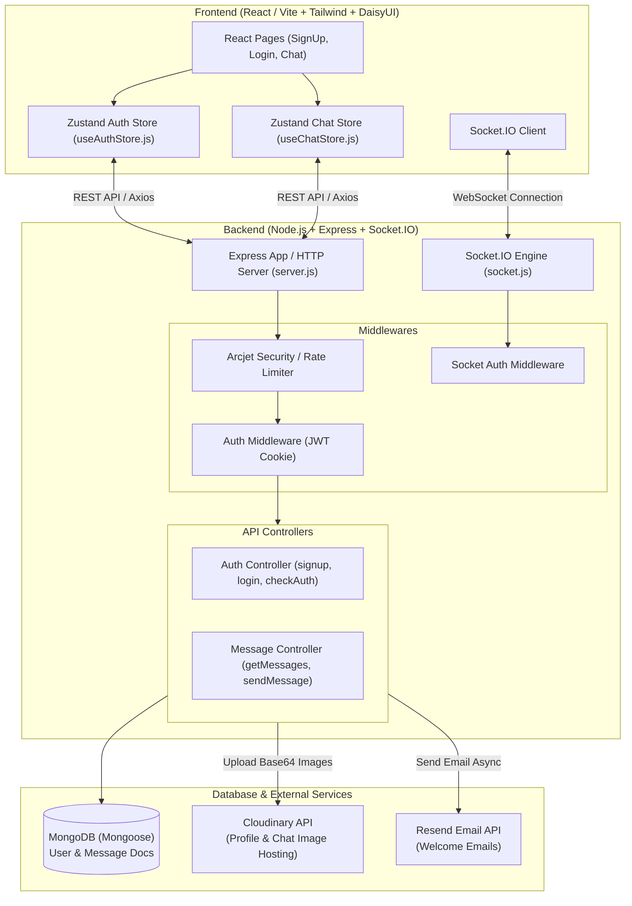
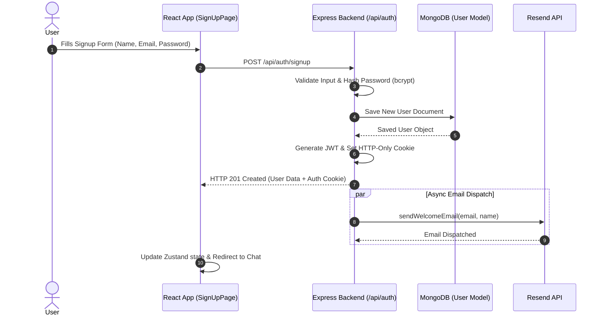
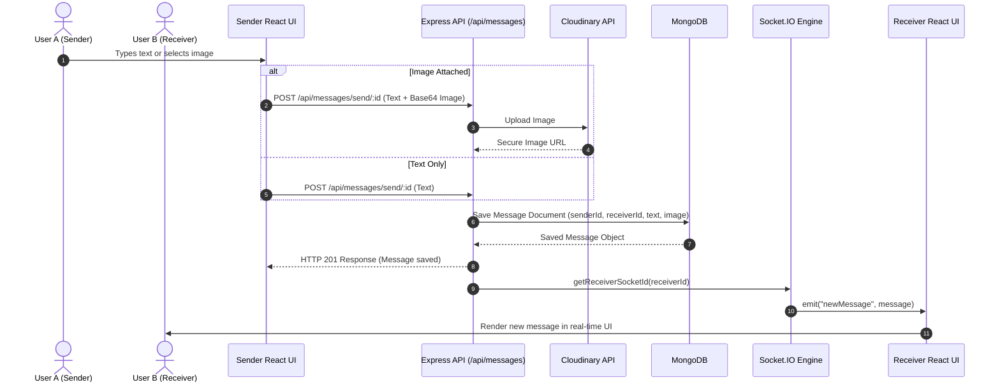
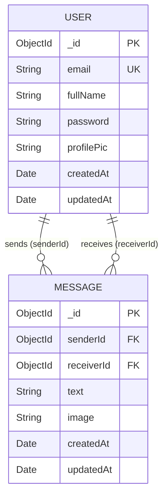

# Chatify Application Architecture & System Flowcharts

This document provides a comprehensive visual guide to the **Chatify** full-stack real-time chat application architecture, user authentication flow, real-time messaging pipeline, and database relationships.

---

## Visual Architecture Overview

---

## 1. High-Level System Architecture

---

## 2. User Authentication & Registration Flow

---

## 3. Real-Time Messaging & Image Sharing Flow

---

## 4. Database Schema Relationships (ER Diagram)

